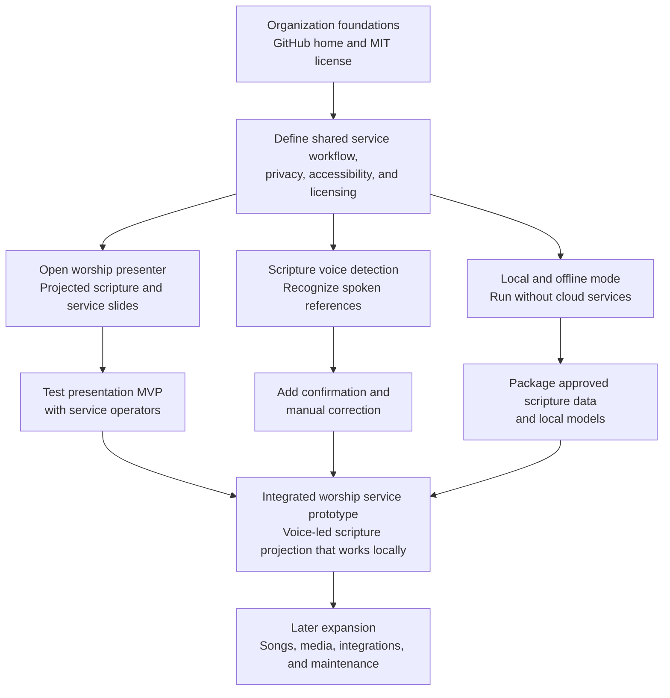
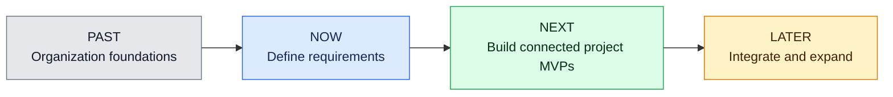

# The Open Church Project

The Open Church Project is an open-source effort to build useful, welcoming
tools for church communities. The planned product direction is an open
alternative to worship presentation software such as EasyWorship: detect spoken
scripture references and project the matching passages so scripture slides can
follow the service, with local/offline operation as a goal.

The project is at an early planning stage. The roadmap below is a proposal, not
a promise or a dated delivery schedule. We’ll refine it with feedback from the
people and communities the work is meant to serve.

## Organization roadmap

The organization currently has one public repository:

| Repository | Status | Purpose |
| --- | --- | --- |
| [`.github`](https://github.com/the-open-church-project/.github) | Active | Project direction, organization documentation, and collaboration guidance |

No product repositories, releases, or completed application features are
documented yet. The remaining projects below are proposed workstreams, not
existing repositories or finished products.

## Project portfolio

| Project | Status | Now | Next | Later |
| --- | --- | --- | --- | --- |
| Organization documentation | Active | Keep the roadmap and contribution guidance accurate | Add templates and clear project governance | Maintain documentation across all repositories |
| Open worship presenter | Proposed | Define the operator workflow and projector requirements | Build a focused scripture presentation MVP and test it in services | Add other service presentation needs such as songs and media |
| Scripture voice detection | Proposed | Choose reference patterns, supported languages, and approved scripture sources | Prototype speech recognition, reference matching, confirmation, and manual fallback | Improve accuracy from real-world feedback without exposing private audio |
| Local and offline operation | Proposed | Decide how audio, scripture data, and models can remain on the device | Make the first complete workflow run without an internet connection | Package simple installation, updates, and supported hardware guidance |

## Delivery roadmap

### Past: organization foundations

- The project’s GitHub home was established.
- The repository was given an MIT license.
- No completed product features or releases are documented here yet.

### Now: define each project's first useful goal

- Work with churches and service operators to define the first scripture
  projection workflow and the equipment it needs to support.
- Decide how spoken references will be detected, which scripture text sources
  can be used, and how operators can confirm or correct a match.
- Define local/offline operation, including how audio is handled, and set
  expectations for accessibility, privacy, and maintenance.

### Next: build and test the connected MVPs

The first useful releases could include:

- A presentation view that displays scripture passages clearly on a projector.
- Voice detection to identify spoken scripture references and bring up the
  matching passage, with operator controls and a manual fallback.
- A local mode designed to keep working without an internet connection.
- Testing in real services to improve recognition, reliability, and ease of use.

### Later: integrate and grow carefully

- Connect the presenter, recognition, and local operation work into one
  reliable service workflow.
- Consider support for other service presentation needs, such as songs or
  media, based on community feedback.
- Explore integrations only when there is a clear need and someone to maintain
  them.
- Document supported scripture sources, setup, privacy practices, and ongoing
  maintenance.

These are ideas to discuss, not commitments. Priorities may change as we learn.

## How to contribute

You don’t need to be a developer to help. Questions, experience, feedback, and
clear documentation are valuable contributions.

1. **Start with the need.** Open an issue in the repository where the relevant
   work lives. Describe who would benefit, what problem you’ve observed, and
   any accessibility or privacy considerations. For broad ideas, use a
   discussion if one is available.
2. **Talk it through.** Check for existing conversations and ask questions
   before starting substantial work. This helps the community agree on scope
   and avoid duplicated effort.
3. **Make focused changes.** For code or documentation, fork the repository,
   make a small change on a branch, and open a pull request explaining the
   problem and how you checked the change.
4. **Be considerate.** Collaborate respectfully, welcome different
   perspectives, and keep feedback constructive. Don’t include passwords,
   private contact details, or sensitive personal or pastoral information in
   public issues or pull requests.

## Collaboration

We aim to make decisions in the open. Share the problem and evidence behind a
proposal, invite input from affected communities, and be clear about trade-offs.
Maintainers and contributors should help keep work focused, accessible, and
small enough to review. If a proposal is not ready to build, it can remain an
open question while we learn more.

## Support

For project or contribution questions, open an issue in the relevant repository
(or a discussion if available) and include enough detail for others to help.
For a problem with a particular tool, include steps to reproduce it and avoid
posting private or sensitive information.

This project’s public channels are not a crisis, emergency, or pastoral-care
service. Please contact an appropriate local or professional support service
for those needs.