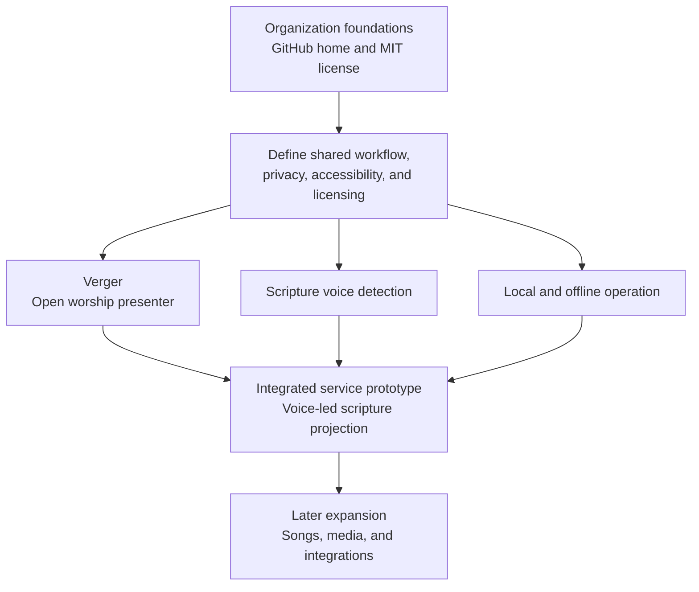
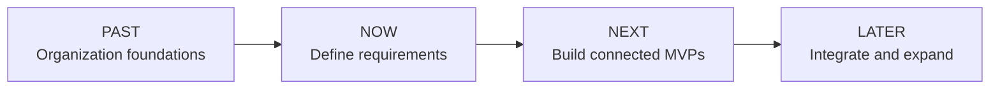

# The Open Church Project: organization roadmap

This is the global roadmap for the organization. Project-specific details live
in their own roadmap directories.

## Current repositories

The organization currently has one public repository:

| Repository | Status | Purpose |
| --- | --- | --- |
| [`.github`](https://github.com/the-open-church-project/.github) | Active | Project direction, organization documentation, and collaboration guidance |

No product repositories, releases, or completed application features are
documented yet. The other projects below are proposed workstreams.

## Organization view

## Project portfolio

| Project | Status | Now | Next | Roadmap |
| --- | --- | --- | --- | --- |
| Organization documentation | Active | Keep this map and contribution guidance accurate | Add templates and governance as repositories are created | This document |
| Verger | Proposed | Define the operator and projector workflow | Build and test a focused scripture presentation MVP | [`roadmaps/verger/`](roadmaps/verger/ROADMAP.md) |
| Scripture voice detection | Proposed | Choose reference patterns, languages, and approved scripture sources | Prototype recognition, matching, confirmation, and fallback | [`roadmaps/scripture-voice/`](roadmaps/scripture-voice/ROADMAP.md) |
| Local and offline operation | Proposed | Define on-device audio, data, and model requirements | Make the integrated workflow usable without the internet | [`roadmaps/local-offline/`](roadmaps/local-offline/ROADMAP.md) |

## Cross-project stages

### Past

- Establish the project’s GitHub home.
- Add an MIT license.
- Define the initial product direction as open, privacy-conscious worship
  presentation with voice-led scripture projection and local operation.

### Now

- Work with churches and service operators to define practical service needs.
- Decide how the projects exchange scripture references and presentation state.
- Set expectations for accessibility, privacy, scripture text licensing, and
  supported languages.

### Next

- Build focused MVPs for presentation, scripture recognition, and local
  operation.
- Test them together in real services with clear operator controls and manual
  fallbacks.

### Later

- Integrate reliable service workflows into a simple installable product.
- Consider songs, media, supported integrations, and ongoing maintenance based
  on community feedback.

These ideas are not commitments. Priorities may change as we learn.
