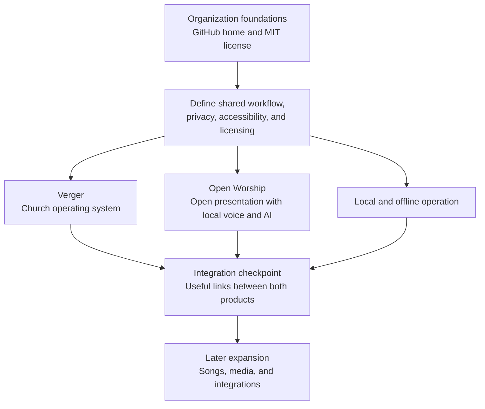
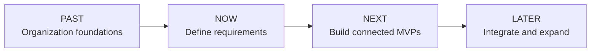

# The Open Church Project: organization roadmap

This is the global roadmap for the organization. Project-specific details live
in their own roadmap directories.

## Current repositories

The organization currently has one public repository:

| Repository | Status | Purpose |
| --- | --- | --- |
| [`.github`](https://github.com/the-open-church-project/.github) | Active | Project direction, organization documentation, and collaboration guidance |

No product repositories, releases, or completed application features are
documented yet. The other projects below are proposed workstreams.

## Organization view

## Project portfolio

| Project | Status | Now | Next | Roadmap |
| --- | --- | --- | --- | --- |
| Organization documentation | Active | Keep this map and contribution guidance accurate | Add templates and governance as repositories are created | This document |
| Verger | Proposed | Define the connected church management workflows | Build and test a focused church operations MVP | [`roadmaps/verger/`](roadmaps/verger/ROADMAP.md) |
| Open Worship | Proposed | Define scripture presentation and local recognition requirements | Build and test an EasyWorship-style open presentation MVP | [`roadmaps/open-worship/`](roadmaps/open-worship/ROADMAP.md) |
| Local and offline operation | Proposed | Define on-device audio, data, and model requirements | Make the integrated workflow usable without the internet | [`roadmaps/local-offline/`](roadmaps/local-offline/ROADMAP.md) |

## Cross-project stages

### Past

- Establish the project’s GitHub home.
- Add an MIT license.
- Define the initial product direction as open, privacy-conscious worship
  presentation with voice-led scripture projection and local operation.

### Now

- Work with churches to define practical administration and service needs.
- Define how Verger and Open Worship remain separate products while sharing
  useful integrations.
- Decide how Open Worship exchanges scripture references and presentation
  state, and set expectations for accessibility, privacy, scripture licensing,
  and supported languages.

### Next

- Build focused MVPs for church operations and worship presentation.
- Add local voice and AI scripture recognition to Open Worship.
- Test the products in real churches with clear operator controls and manual
  fallbacks.

### Later

- Connect useful Verger workflows with Open Worship without coupling the
  products.
- Consider songs, media, additional church workflows, supported integrations,
  and ongoing maintenance based on community feedback.

These ideas are not commitments. Priorities may change as we learn.
