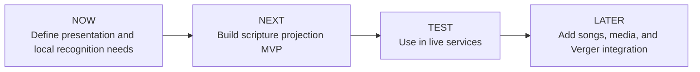

# Open Worship roadmap

Open Worship is the proposed open-source worship presentation product, intended
as an open alternative to tools such as EasyWorship. It will project scripture
and other service content and use local voice and local AI recognition to help
matching scripture follow the service.

## Status

Proposed. No Open Worship repository or implementation is documented yet.

## Roadmap

### Now

- Work with service operators to define the projection, preview, correction,
  and emergency control workflow.
- Define supported scripture references, languages, and approved text sources.
- Select local speech and AI model requirements, including accuracy, latency,
  hardware, licenses, and on-device privacy.

### Next

- Build a clear projector view and separate operator view.
- Use local voice and local AI recognition to suggest spoken scripture
  references and the matching passages.
- Let operators confirm, correct, or dismiss suggestions, with complete manual
  entry as a fallback.
- Run the core presentation workflow without an internet connection.

### Later

- Add songs, media, service lists, themes, and reusable presentations.
- Improve recognition for more voices, accents, languages, and service contexts.
- Explore useful integration with Verger while keeping Open Worship usable as a
  standalone product.
- Package tested local models and document supported installation hardware.

## Open questions

- Which scripture sources may be redistributed and used offline?
- Which local speech and AI models meet performance, hardware, and licensing
  requirements?
- How should Open Worship present uncertainty and recover from recognition or
  display failure during a service?
