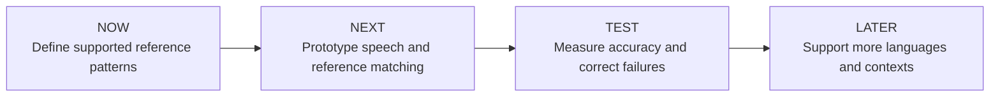

# Scripture voice detection roadmap

This proposed project will recognize spoken scripture references so Verger can
find and display the matching passage. It must remain operator-led: uncertain
recognition should be easy to review, correct, or ignore.

## Status

Proposed. No recognition repository or model is documented yet.

## Roadmap

### Now

- Define supported books, abbreviations, chapter and verse formats, and
  languages.
- Identify approved scripture data sources and their license requirements.
- Decide how audio is captured, retained, processed, and deleted.
- Set a useful accuracy and latency target for a live service.

### Next

- Prototype recognition using local models.
- Convert recognized speech into normalized scripture references.
- Return confidence and alternatives to the presentation operator.
- Provide manual entry and correction as a complete fallback.

### Later

- Improve accuracy with service audio and diverse voices and accents.
- Add supported languages and terminology where licensed data is available.
- Keep tests and privacy documentation current as models change.

## Open questions

- Should recognition run entirely on the presentation computer?
- Which local speech models meet performance and licensing requirements?
- How should sensitive sermon audio be handled during testing and support?
