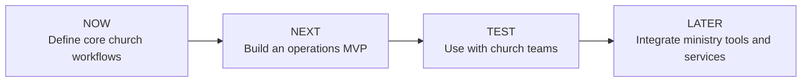

# Verger roadmap

Verger is the proposed open-source church operating system. It is the broader
product for coordinating church administration and ministry work, while Open
Worship handles the live presentation needs of a service.

## Status

Proposed. No Verger repository or implementation is documented yet.

## Roadmap

### Now

- Work with church leaders, administrators, and volunteers to identify repeated
  operational work and the first valuable workflows.
- Define roles, permissions, data ownership, privacy, and accessibility
  requirements.
- Decide which capabilities belong in Verger and which should remain separate
  products.

### Next

- Build a focused operating-system MVP for one agreed church workflow.
- Provide clear administration, role-based access, and practical exports.
- Explore integration with Open Worship without requiring it.

### Later

- Expand into additional church operations, ministry workflows, and reporting.
- Add supported integrations with clear owners, privacy expectations, and
  maintenance commitments.
- Develop a local or self-hosted option where reliable and practical.

## Open questions

- Which church workflow creates the clearest first value?
- Which records need local storage, self-hosting, or strict access controls?
- Which Open Worship data, if any, should be available inside Verger?
