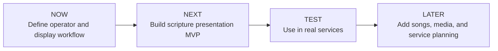

# Verger roadmap

Verger is the proposed open-source worship presentation application. It should
help an operator display scripture and other service content clearly, with
voice-led scripture follow-through and local operation as key goals.

## Status

Proposed. No Verger repository or implementation is documented yet.

## Roadmap

### Now

- Interview service operators about how they prepare and run services.
- Define projector, preview, confidence display, and emergency control needs.
- Agree on keyboard, accessibility, and low-technical-skill requirements.

### Next

- Build a projector presentation view for approved scripture passages.
- Add an operator preview and controls to accept, correct, or dismiss a
  detected reference.
- Integrate with scripture voice detection and local operation.

### Later

- Add service schedules, songs, media, themes, and reusable presentations.
- Document installation and supported display setups.
- Explore integrations only where they have a clear maintainer and purpose.

## Open questions

- Which operating systems and projector setups must the first release support?
- Which scripture text sources can be redistributed or used offline?
- How should Verger behave when recognition is unavailable or uncertain?
